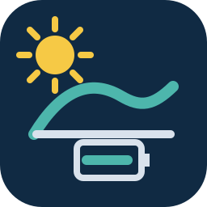

<p align="center">
  
</p>

# SolarEdge Monitoring Bridge

Read whole-site SolarEdge solar, grid, consumption, and battery telemetry in
Home Assistant using any monitoring account with site access—site ownership is
not required.

It supports two read-only connection methods:

- **SolarEdge monitoring portal (experimental):** logs in directly with any
  SolarEdge monitoring account that can access the site and a numeric site ID;
  the account does not need to own the site.
- **Local snapshot bridge:** consumes the documented protocol in
  [docs/snapshot-protocol.md](docs/snapshot-protocol.md).

> [!WARNING]
> Direct portal access uses SolarEdge's undocumented private web interface. It is
> unofficial, is not endorsed by SolarEdge, and may stop working without notice.
> Use it only with an account and site you are authorized to access. Multi-factor
> authentication, federated sign-in, or a changed login page may prevent setup.

## Why this integration

The portal connection fills a common access gap: you can view a site in
SolarEdge Monitoring, but you do not own the site and may not have API
credentials or local inverter access. Any monitoring account with permission to
view the site is sufficient.

From that access, the integration exposes:

- explicit grid import/export and battery charge/discharge direction;
- cumulative whole-site energy counters suitable for the Energy dashboard;
- a storage operating-plan label when available; and
- observation time and per-field completeness information.

If you have official API credentials or local Modbus access, those documented
connection methods remain preferable. The portal option covers read-only access
when those methods are unavailable.

## Entities

The integration creates up to fourteen entities. Missing or explicitly
incomplete fields are unavailable rather than guessed.

- Production and consumption power
- Grid import and export power
- Battery charge and discharge power
- Battery state of energy
- Lifetime production and consumption energy
- Lifetime grid import and export energy
- Lifetime battery charged and discharged energy
- Storage operating-plan label, with bounded `active` and `block_count`
  attributes

Power is expressed in W, energy in kWh, and state of energy in percent.

## Installation

### HACS custom repository

[](https://my.home-assistant.io/redirect/hacs_repository/?owner=shogun301&repository=solaredge-monitoring-bridge&category=integration)

1. In HACS, add
   `https://github.com/shogun301/solaredge-monitoring-bridge` as an
   **Integration** custom repository.
2. Install **SolarEdge Monitoring Bridge**.
3. Restart Home Assistant.
4. Add **SolarEdge Monitoring** under Settings > Devices & services.

An inclusion request is pending for HACS's default catalog. Until it is
accepted, the custom-repository step is required.

### Manual

Copy `custom_components/solaredge_one_bridge` into Home Assistant's
`custom_components` directory, restart Home Assistant, and add the integration.

## Portal setup

Select **SolarEdge monitoring portal (experimental)** and enter:

- the email and password used for the SolarEdge monitoring portal;
- the numeric site ID for the site you are authorized to view; and
- the site's IANA time-zone name, such as `America/Los_Angeles`.

Home Assistant stores these values in its config-entry storage, as it does for
other credentialed integrations. Credentials and site identifiers are redacted
from diagnostics and never become entity state or attributes.

The client is deliberately constrained:

- authentication is sent only to exact SolarEdge login and monitoring hosts;
- only a fixed read-only dashboard endpoint set can be called;
- cross-host login forms, redirects, embedded URL credentials, and unsafe
  redirects are rejected;
- responses are bounded before parsing;
- one authentication retry is allowed after a rejected session;
- provider responses are recursively stripped of common secret and identifying
  fields before normalization; and
- Home Assistant retains only the aggregate snapshot allowlist.

The integration polls every five minutes by default. Do not lower the interval
unnecessarily; the portal is not a documented public API.

## Local bridge setup

Select **Compatible local snapshot bridge** and enter a private/local snapshot
URL plus its high-entropy shared secret. The config flow refuses public
fully-qualified hostnames, embedded URL credentials, query strings, fragments,
and redirects. Single-label hostnames are allowed for add-on/container DNS.

A minimal synthetic snapshot is:

```json
{
  "schema_version": 1,
  "connected": true,
  "observed_at": "2026-01-15T20:05:00Z",
  "provider": "documented_api",
  "site": {
    "production_power_w": 5400.0,
    "consumption_power_w": 3100.0,
    "grid_export_power_w": 1800.0,
    "battery_charge_power_w": 500.0,
    "battery_state_of_energy_pct": 72.4,
    "production_energy_kwh": 12345.678
  },
  "completeness": {
    "production_power_w": true,
    "consumption_power_w": true,
    "grid_export_power_w": true
  }
}
```

The complete contract is in
[docs/snapshot-protocol.md](docs/snapshot-protocol.md).

## Security and privacy

- Only allowlisted aggregate fields are retained.
- Unknown fields are ignored, including site IDs, addresses, serial numbers,
  credentials, cookies, tokens, and arbitrary metadata.
- Credentials, site ID, local endpoint, and shared secret are redacted from
  diagnostics.
- Raw metric values and provider payloads are omitted from diagnostics.
- Connected snapshots must be recent and timezone-aware.
- Portal errors are deliberately non-sensitive.

Please read [SECURITY.md](SECURITY.md) before sharing logs or filing an issue.

## Development

```bash
python -m pip install pytest aiohttp ruff tzdata
ruff check .
pytest -q
python scripts/privacy_scan.py
```

GitHub Actions also runs HACS validation, Home Assistant hassfest, and gitleaks.

## Trademark and affiliation

This community project is not affiliated with, sponsored by, or endorsed by
SolarEdge Technologies. SolarEdge is a trademark of its respective owner. The
project artwork is original and does not reproduce the SolarEdge logo.
The editable SVG mark and 256/512-pixel PNG exports are included under
`assets/`; Home Assistant-ready copies are bundled in the integration's
`brand/` directory.

## License

Apache License 2.0. See [LICENSE](LICENSE).
